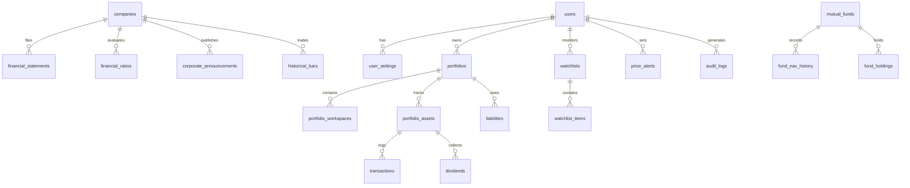

# DATABASE SCHEMA SPECIFICATION: Grow More and Stable Life
**PostgreSQL Relational Schema, Indexes, Foreign Keys & Constraints**

---

## 1. Schema Design Principles

The database schema is fully normalized (3NF), strictly enforced with PostgreSQL constraints, foreign keys, cascade policies, and specialized indexes (B-Tree, GIN, and composite indexes).
1. **Financial Precision**: All monetary values, transaction quantities, share prices, exchange rates, and financial ratios use `NUMERIC(20, 6)` or `NUMERIC(24, 8)` to prevent IEEE 754 floating-point rounding errors.
2. **Historical Integrity**: Transactions, dividends, corporate actions, and historical exchange rates are immutable append-only records with audit trails. Deleting a transaction creates a soft-deletion record for complete audit accountability.
3. **Multi-Currency Support**: Every holding, transaction, asset, and cash ledger records both its native currency and the base portfolio currency, alongside the exact historical exchange rate at execution time.
4. **Tenant Isolation**: Row-Level Security (RLS) and foreign key relationships guarantee that users can access only their own portfolios, watchlists, accounts, and private financial data.

---

## 2. Entity-Relationship Diagram (Core Domains)



---

## 3. Detailed Table Definitions (DDL)

### 3.1 Authentication & User Management Domain

```sql
-- 1. USERS TABLE
CREATE TABLE users (
    id UUID PRIMARY KEY DEFAULT gen_random_uuid(),
    email VARCHAR(255) UNIQUE NOT NULL,
    hashed_password VARCHAR(255) NOT NULL,
    full_name VARCHAR(255) NOT NULL,
    role VARCHAR(50) NOT NULL DEFAULT 'user' CHECK (role IN ('user', 'advisor', 'admin', 'superadmin')),
    is_active BOOLEAN NOT NULL DEFAULT TRUE,
    is_verified BOOLEAN NOT NULL DEFAULT FALSE,
    two_factor_enabled BOOLEAN NOT NULL DEFAULT FALSE,
    two_factor_secret VARCHAR(255),
    phone_number VARCHAR(50),
    country_code VARCHAR(10) DEFAULT 'PK',
    created_at TIMESTAMPTZ NOT NULL DEFAULT NOW(),
    updated_at TIMESTAMPTZ NOT NULL DEFAULT NOW()
);

-- 2. USER SETTINGS TABLE
CREATE TABLE user_settings (
    id UUID PRIMARY KEY DEFAULT gen_random_uuid(),
    user_id UUID NOT NULL UNIQUE REFERENCES users(id) ON DELETE CASCADE,
    base_currency VARCHAR(10) NOT NULL DEFAULT 'PKR' CHECK (base_currency IN ('PKR', 'USD', 'SAR', 'EUR', 'GBP', 'AED')),
    theme_mode VARCHAR(20) NOT NULL DEFAULT 'system' CHECK (theme_mode IN ('light', 'dark', 'system')),
    color_palette VARCHAR(50) NOT NULL DEFAULT 'default',
    default_market VARCHAR(10) NOT NULL DEFAULT 'PK' CHECK (default_market IN ('PK', 'US', 'SA')),
    email_notifications BOOLEAN NOT NULL DEFAULT TRUE,
    price_alert_notifications BOOLEAN NOT NULL DEFAULT TRUE,
    created_at TIMESTAMPTZ NOT NULL DEFAULT NOW(),
    updated_at TIMESTAMPTZ NOT NULL DEFAULT NOW()
);
```

### 3.2 Portfolio Management Domain

```sql
-- 3. PORTFOLIOS TABLE
CREATE TABLE portfolios (
    id UUID PRIMARY KEY DEFAULT gen_random_uuid(),
    user_id UUID NOT NULL REFERENCES users(id) ON DELETE CASCADE,
    name VARCHAR(255) NOT NULL,
    description TEXT,
    base_currency VARCHAR(10) NOT NULL DEFAULT 'PKR',
    is_primary BOOLEAN NOT NULL DEFAULT FALSE,
    is_public BOOLEAN NOT NULL DEFAULT FALSE,
    share_token VARCHAR(255) UNIQUE,
    created_at TIMESTAMPTZ NOT NULL DEFAULT NOW(),
    updated_at TIMESTAMPTZ NOT NULL DEFAULT NOW()
);

-- 4. PORTFOLIO ASSETS (HOLDINGS SUMMARY) TABLE
CREATE TABLE portfolio_assets (
    id UUID PRIMARY KEY DEFAULT gen_random_uuid(),
    portfolio_id UUID NOT NULL REFERENCES portfolios(id) ON DELETE CASCADE,
    asset_type VARCHAR(50) NOT NULL CHECK (asset_type IN (
        'stock', 'etf', 'mutual_fund', 'crypto', 'forex', 'commodity',
        'real_estate', 'cash', 'fixed_deposit', 'investment_plan', 'other'
    )),
    symbol VARCHAR(50) NOT NULL,
    name VARCHAR(255) NOT NULL,
    market VARCHAR(20) NOT NULL DEFAULT 'PK' CHECK (market IN ('PK', 'US', 'SA', 'CRYPTO', 'FOREX', 'COMMODITY', 'OTHER')),
    currency VARCHAR(10) NOT NULL DEFAULT 'PKR',
    quantity NUMERIC(24, 8) NOT NULL DEFAULT 0,
    average_buy_price NUMERIC(20, 6) NOT NULL DEFAULT 0,
    total_cost_basis NUMERIC(20, 6) NOT NULL DEFAULT 0,
    current_market_price NUMERIC(20, 6) NOT NULL DEFAULT 0,
    current_market_value NUMERIC(20, 6) NOT NULL DEFAULT 0,
    unrealized_pnl NUMERIC(20, 6) NOT NULL DEFAULT 0,
    unrealized_pnl_percent NUMERIC(10, 4) NOT NULL DEFAULT 0,
    realized_pnl NUMERIC(20, 6) NOT NULL DEFAULT 0,
    last_price_updated_at TIMESTAMPTZ,
    notes TEXT,
    created_at TIMESTAMPTZ NOT NULL DEFAULT NOW(),
    updated_at TIMESTAMPTZ NOT NULL DEFAULT NOW(),
    CONSTRAINT uq_portfolio_asset UNIQUE(portfolio_id, asset_type, symbol, market)
);

-- 5. TRANSACTIONS TABLE
CREATE TABLE transactions (
    id UUID PRIMARY KEY DEFAULT gen_random_uuid(),
    portfolio_asset_id UUID NOT NULL REFERENCES portfolio_assets(id) ON DELETE CASCADE,
    portfolio_id UUID NOT NULL REFERENCES portfolios(id) ON DELETE CASCADE,
    transaction_type VARCHAR(30) NOT NULL CHECK (transaction_type IN ('buy', 'sell', 'dividend', 'bonus', 'split', 'deposit', 'withdrawal', 'fee')),
    transaction_date DATE NOT NULL,
    quantity NUMERIC(24, 8) NOT NULL,
    unit_price NUMERIC(20, 6) NOT NULL,
    total_amount NUMERIC(20, 6) NOT NULL,
    fees NUMERIC(20, 6) NOT NULL DEFAULT 0,
    taxes NUMERIC(20, 6) NOT NULL DEFAULT 0,
    net_amount NUMERIC(20, 6) NOT NULL,
    currency VARCHAR(10) NOT NULL DEFAULT 'PKR',
    exchange_rate_to_base NUMERIC(18, 8) NOT NULL DEFAULT 1.0,
    realized_gain_loss NUMERIC(20, 6) DEFAULT 0,
    notes TEXT,
    is_deleted BOOLEAN NOT NULL DEFAULT FALSE,
    created_at TIMESTAMPTZ NOT NULL DEFAULT NOW(),
    updated_at TIMESTAMPTZ NOT NULL DEFAULT NOW()
);

-- 6. DIVIDENDS TABLE
CREATE TABLE dividends (
    id UUID PRIMARY KEY DEFAULT gen_random_uuid(),
    portfolio_asset_id UUID NOT NULL REFERENCES portfolio_assets(id) ON DELETE CASCADE,
    portfolio_id UUID NOT NULL REFERENCES portfolios(id) ON DELETE CASCADE,
    ex_date DATE,
    payment_date DATE NOT NULL,
    dividend_per_share NUMERIC(20, 6) NOT NULL,
    gross_amount NUMERIC(20, 6) NOT NULL,
    withholding_tax NUMERIC(20, 6) NOT NULL DEFAULT 0,
    zakat_deduction NUMERIC(20, 6) NOT NULL DEFAULT 0,
    net_amount NUMERIC(20, 6) NOT NULL,
    purification_rate_pct NUMERIC(8, 4) DEFAULT 0,
    purification_amount NUMERIC(20, 6) DEFAULT 0,
    currency VARCHAR(10) NOT NULL DEFAULT 'PKR',
    notes TEXT,
    created_at TIMESTAMPTZ NOT NULL DEFAULT NOW()
);

-- 7. LIABILITIES & LOANS TABLE
CREATE TABLE liabilities (
    id UUID PRIMARY KEY DEFAULT gen_random_uuid(),
    portfolio_id UUID NOT NULL REFERENCES portfolios(id) ON DELETE CASCADE,
    liability_name VARCHAR(255) NOT NULL,
    liability_type VARCHAR(50) NOT NULL CHECK (liability_type IN ('mortgage', 'personal_loan', 'auto_loan', 'credit_card', 'business_loan', 'other')),
    original_principal NUMERIC(20, 6) NOT NULL,
    outstanding_balance NUMERIC(20, 6) NOT NULL,
    interest_rate_annual NUMERIC(8, 4) NOT NULL,
    monthly_payment_emi NUMERIC(20, 6) NOT NULL,
    start_date DATE NOT NULL,
    end_date DATE,
    currency VARCHAR(10) NOT NULL DEFAULT 'PKR',
    notes TEXT,
    created_at TIMESTAMPTZ NOT NULL DEFAULT NOW(),
    updated_at TIMESTAMPTZ NOT NULL DEFAULT NOW()
);
```

### 3.3 Market Data & Securities Domain

```sql
-- 8. COMPANIES TABLE
CREATE TABLE companies (
    id UUID PRIMARY KEY DEFAULT gen_random_uuid(),
    symbol VARCHAR(50) NOT NULL,
    market VARCHAR(20) NOT NULL DEFAULT 'PK' CHECK (market IN ('PK', 'US', 'SA')),
    name VARCHAR(255) NOT NULL,
    legal_name VARCHAR(255),
    sector VARCHAR(100) NOT NULL,
    industry VARCHAR(100),
    description TEXT,
    website VARCHAR(255),
    ceo VARCHAR(255),
    employees INTEGER,
    isin VARCHAR(50),
    fiscal_year_end VARCHAR(20),
    is_shariah_compliant BOOLEAN DEFAULT FALSE,
    shariah_screening_authority VARCHAR(100),
    is_active BOOLEAN NOT NULL DEFAULT TRUE,
    created_at TIMESTAMPTZ NOT NULL DEFAULT NOW(),
    updated_at TIMESTAMPTZ NOT NULL DEFAULT NOW(),
    CONSTRAINT uq_company_symbol_market UNIQUE(symbol, market)
);

-- 9. HISTORICAL BARS (OHLCV) TABLE
CREATE TABLE historical_bars (
    id BIGSERIAL PRIMARY KEY,
    symbol VARCHAR(50) NOT NULL,
    market VARCHAR(20) NOT NULL,
    resolution VARCHAR(10) NOT NULL CHECK (resolution IN ('1m', '5m', '15m', '1h', '1D', '1W', '1M')),
    bar_time TIMESTAMPTZ NOT NULL,
    open_price NUMERIC(20, 6) NOT NULL,
    high_price NUMERIC(20, 6) NOT NULL,
    low_price NUMERIC(20, 6) NOT NULL,
    close_price NUMERIC(20, 6) NOT NULL,
    volume NUMERIC(24, 4) NOT NULL DEFAULT 0,
    value_traded NUMERIC(24, 4) DEFAULT 0,
    source VARCHAR(50) NOT NULL,
    created_at TIMESTAMPTZ NOT NULL DEFAULT NOW(),
    CONSTRAINT uq_historical_bar UNIQUE(symbol, market, resolution, bar_time)
);

-- 10. FINANCIAL STATEMENTS TABLE
CREATE TABLE financial_statements (
    id UUID PRIMARY KEY DEFAULT gen_random_uuid(),
    company_id UUID NOT NULL REFERENCES companies(id) ON DELETE CASCADE,
    statement_type VARCHAR(30) NOT NULL CHECK (statement_type IN ('income_statement', 'balance_sheet', 'cash_flow')),
    period_type VARCHAR(20) NOT NULL CHECK (period_type IN ('annual', 'quarterly')),
    fiscal_year INTEGER NOT NULL,
    fiscal_period VARCHAR(10) NOT NULL, -- e.g., 'Q1', 'Q2', 'Q3', 'FY'
    filing_date DATE NOT NULL,
    currency VARCHAR(10) NOT NULL DEFAULT 'PKR',
    data JSONB NOT NULL, -- Full statement lines structured as JSONB
    created_at TIMESTAMPTZ NOT NULL DEFAULT NOW(),
    updated_at TIMESTAMPTZ NOT NULL DEFAULT NOW(),
    CONSTRAINT uq_statement UNIQUE(company_id, statement_type, fiscal_year, fiscal_period)
);

-- 11. FINANCIAL RATIOS & SCORES TABLE
CREATE TABLE financial_ratios (
    id UUID PRIMARY KEY DEFAULT gen_random_uuid(),
    company_id UUID NOT NULL REFERENCES companies(id) ON DELETE CASCADE,
    as_of_date DATE NOT NULL,
    pe_ratio NUMERIC(10, 4),
    pb_ratio NUMERIC(10, 4),
    ps_ratio NUMERIC(10, 4),
    roe_pct NUMERIC(10, 4),
    roa_pct NUMERIC(10, 4),
    roce_pct NUMERIC(10, 4),
    net_profit_margin_pct NUMERIC(10, 4),
    operating_margin_pct NUMERIC(10, 4),
    gross_margin_pct NUMERIC(10, 4),
    debt_to_equity NUMERIC(10, 4),
    current_ratio NUMERIC(10, 4),
    quick_ratio NUMERIC(10, 4),
    interest_coverage NUMERIC(10, 4),
    dividend_yield_pct NUMERIC(10, 4),
    dividend_payout_pct NUMERIC(10, 4),
    health_score NUMERIC(5, 2), -- 0 to 100
    quality_score NUMERIC(5, 2), -- 0 to 100
    growth_score NUMERIC(5, 2), -- 0 to 100
    stability_score NUMERIC(5, 2), -- 0 to 100
    value_score NUMERIC(5, 2), -- 0 to 100
    estimated_intrinsic_dcf NUMERIC(20, 6),
    peter_lynch_fair_value NUMERIC(20, 6),
    created_at TIMESTAMPTZ NOT NULL DEFAULT NOW(),
    CONSTRAINT uq_company_ratios_date UNIQUE(company_id, as_of_date)
);

-- 12. MUTUAL FUNDS TABLE
CREATE TABLE mutual_funds (
    id UUID PRIMARY KEY DEFAULT gen_random_uuid(),
    fund_symbol VARCHAR(50) UNIQUE NOT NULL,
    fund_name VARCHAR(255) NOT NULL,
    amc_name VARCHAR(255) NOT NULL,
    category VARCHAR(100) NOT NULL,
    shariah_status VARCHAR(50) DEFAULT 'Conventional',
    inception_date DATE,
    currency VARCHAR(10) NOT NULL DEFAULT 'PKR',
    expense_ratio_pct NUMERIC(6, 4),
    latest_nav NUMERIC(18, 6) NOT NULL,
    nav_date DATE NOT NULL,
    aum_pkr NUMERIC(24, 2),
    aum_date DATE,
    ytd_return_pct NUMERIC(10, 4),
    one_year_return_pct NUMERIC(10, 4),
    three_year_return_pct NUMERIC(10, 4),
    five_year_return_pct NUMERIC(10, 4),
    dividend_yield_pct NUMERIC(8, 4),
    created_at TIMESTAMPTZ NOT NULL DEFAULT NOW(),
    updated_at TIMESTAMPTZ NOT NULL DEFAULT NOW()
);

-- 13. MUTUAL FUND NAV HISTORY TABLE
CREATE TABLE fund_nav_history (
    id BIGSERIAL PRIMARY KEY,
    fund_id UUID NOT NULL REFERENCES mutual_funds(id) ON DELETE CASCADE,
    nav_date DATE NOT NULL,
    nav NUMERIC(18, 6) NOT NULL,
    created_at TIMESTAMPTZ NOT NULL DEFAULT NOW(),
    CONSTRAINT uq_fund_nav_date UNIQUE(fund_id, nav_date)
);

-- 14. MACROECONOMIC INDICATORS TABLE
CREATE TABLE macro_indicators (
    id UUID PRIMARY KEY DEFAULT gen_random_uuid(),
    indicator_code VARCHAR(50) NOT NULL,
    indicator_name VARCHAR(255) NOT NULL,
    category VARCHAR(100) NOT NULL,
    country_code VARCHAR(10) NOT NULL DEFAULT 'PK',
    report_date DATE NOT NULL,
    reported_value NUMERIC(20, 6) NOT NULL,
    previous_value NUMERIC(20, 6),
    unit VARCHAR(50) NOT NULL,
    data_frequency VARCHAR(30) NOT NULL, -- e.g. Monthly, Quarterly, Annual
    source_agency VARCHAR(255) NOT NULL, -- e.g. State Bank of Pakistan, PBS
    notes TEXT,
    created_at TIMESTAMPTZ NOT NULL DEFAULT NOW(),
    CONSTRAINT uq_macro_indicator UNIQUE(indicator_code, report_date)
);

-- 15. CORPORATE ANNOUNCEMENTS TABLE
CREATE TABLE corporate_announcements (
    id UUID PRIMARY KEY DEFAULT gen_random_uuid(),
    market VARCHAR(20) NOT NULL DEFAULT 'PK',
    symbol VARCHAR(50) NOT NULL,
    company_name VARCHAR(255),
    title TEXT NOT NULL,
    category VARCHAR(100) DEFAULT 'corporate_notice',
    announced_at TIMESTAMPTZ NOT NULL,
    date_text VARCHAR(20),
    time_text VARCHAR(20),
    pdf_url TEXT,
    source_url TEXT,
    external_id VARCHAR(255),
    created_at TIMESTAMPTZ NOT NULL DEFAULT NOW(),
    CONSTRAINT uq_announcement_ext UNIQUE(market, external_id)
);
```

### 3.4 User Tools, Watchlists & Administration Domain

```sql
-- 16. WATCHLISTS TABLE
CREATE TABLE watchlists (
    id UUID PRIMARY KEY DEFAULT gen_random_uuid(),
    user_id UUID NOT NULL REFERENCES users(id) ON DELETE CASCADE,
    name VARCHAR(255) NOT NULL,
    is_default BOOLEAN NOT NULL DEFAULT FALSE,
    created_at TIMESTAMPTZ NOT NULL DEFAULT NOW()
);

-- 17. WATCHLIST ITEMS TABLE
CREATE TABLE watchlist_items (
    id UUID PRIMARY KEY DEFAULT gen_random_uuid(),
    watchlist_id UUID NOT NULL REFERENCES watchlists(id) ON DELETE CASCADE,
    asset_type VARCHAR(50) NOT NULL,
    symbol VARCHAR(50) NOT NULL,
    market VARCHAR(20) NOT NULL DEFAULT 'PK',
    added_at TIMESTAMPTZ NOT NULL DEFAULT NOW(),
    CONSTRAINT uq_watchlist_item UNIQUE(watchlist_id, asset_type, symbol, market)
);

-- 18. PRICE ALERTS TABLE
CREATE TABLE price_alerts (
    id UUID PRIMARY KEY DEFAULT gen_random_uuid(),
    user_id UUID NOT NULL REFERENCES users(id) ON DELETE CASCADE,
    symbol VARCHAR(50) NOT NULL,
    market VARCHAR(20) NOT NULL DEFAULT 'PK',
    condition VARCHAR(20) NOT NULL CHECK (condition IN ('above', 'below', 'percent_gain_day', 'percent_loss_day', '52w_high', '52w_low')),
    threshold_value NUMERIC(20, 6) NOT NULL,
    is_active BOOLEAN NOT NULL DEFAULT TRUE,
    is_triggered BOOLEAN NOT NULL DEFAULT FALSE,
    triggered_at TIMESTAMPTZ,
    created_at TIMESTAMPTZ NOT NULL DEFAULT NOW()
);

-- 19. API LOGS & MONITORING TABLE
CREATE TABLE api_logs (
    id BIGSERIAL PRIMARY KEY,
    provider_name VARCHAR(100) NOT NULL,
    endpoint VARCHAR(255) NOT NULL,
    http_method VARCHAR(10) NOT NULL DEFAULT 'GET',
    status_code INTEGER NOT NULL,
    latency_ms INTEGER NOT NULL,
    is_success BOOLEAN NOT NULL,
    error_message TEXT,
    created_at TIMESTAMPTZ NOT NULL DEFAULT NOW()
);

-- 20. AUDIT RECORDS TABLE
CREATE TABLE audit_records (
    id BIGSERIAL PRIMARY KEY,
    user_id UUID REFERENCES users(id) ON DELETE SET NULL,
    action VARCHAR(100) NOT NULL,
    resource_type VARCHAR(100) NOT NULL,
    resource_id VARCHAR(255),
    ip_address VARCHAR(50),
    user_agent TEXT,
    old_values JSONB,
    new_values JSONB,
    created_at TIMESTAMPTZ NOT NULL DEFAULT NOW()
);
```

---

## 4. Key Performance Indexes

```sql
-- Historical Bars Indexing for Time-Series Queries
CREATE INDEX idx_bars_sym_mkt_res_time ON historical_bars (symbol, market, resolution, bar_time DESC);

-- Transaction Queries by Portfolio & Date
CREATE INDEX idx_tx_portfolio_date ON transactions (portfolio_id, transaction_date DESC) WHERE is_deleted = FALSE;

-- Asset Lookup in Portfolios
CREATE INDEX idx_assets_portfolio_sym ON portfolio_assets (portfolio_id, symbol, market);

-- Mutual Fund History Lookup
CREATE INDEX idx_fund_nav_date ON fund_nav_history (fund_id, nav_date DESC);

-- Corporate Announcements Lookup
CREATE INDEX idx_announcements_sym_date ON corporate_announcements (market, symbol, announced_at DESC);

-- API Logging Index for Latency & Health Analysis
CREATE INDEX idx_api_logs_provider_date ON api_logs (provider_name, created_at DESC);
```
